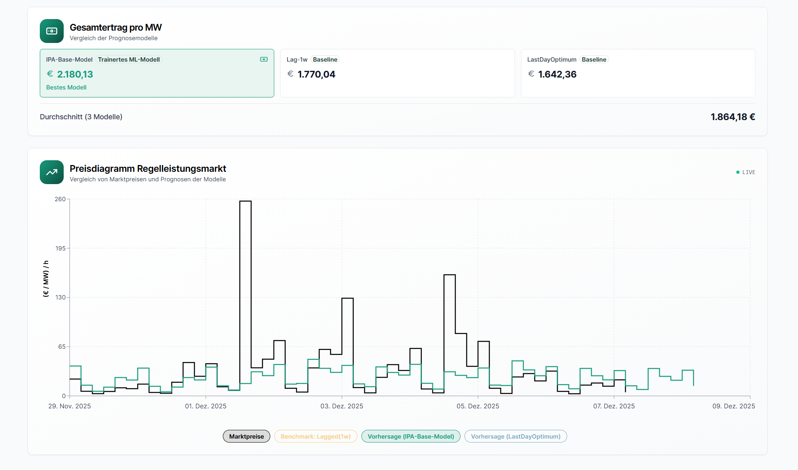

# Research Page | Lukas Baur

 
 

# 👨‍🎓 Supervision
## Currently
_currently available for thesis supervision. Feel free to [contact me](mailto:lukas.baur@ipa.fraunhofer.de)._

## Past

### 2026
- (**master thesis**) *P. Strobel*: Large-scale analysis of the predictability of industrial energy demands using zero-shot models / Large-scale Analyse der Prognostizierbarkeit von industriellen Lasten mittels Zero-Shot Modellen [2026]
- (**master thesis**) *S. Becher*: Profitability analysis of variable electricity price tariffs for industrial energy procurement / Profitabilitätsanalyse von variablen Strompreistarifen für die industrielle Energiebeschaffung [2026]
- (**internship project**) *G. Schmid*: Dashboard for Publicly Available Datasets PADELF [2026]

### 2025
- (**bachelor thesis**) *C. Rappold*: Benchmark of zero-shot prediction models for forecasting electrical loads in an industrial context / Benchmark von Zero-Shot Vorhersagemodellen für die Prognose von elektrischen Lasten im industriellen Kontext [2025]
- (**master thesis**) *D. Gekeler*: Integration of open weather data to improve the forecast of electrical loads of industrial consumers using artificial intelligence (AI) / Integration von Open Data Wetterdaten zur Verbesserung der Prognose von elektrischen Lasten industrieller Verbraucher unter Verwendung von Künstlicher Intelligenz (KI) [2025]
- (**master thesis**) *K. Kunkel*: Predictability of electrical loads of different domains - An empirical study through benchmarking using artificial intelligence (AI) / Prognostizierbarkeit elektrischer Lasten verschiedener Domänen – Eine empirische Untersuchung mittels Benchmark unter Verwendung von Künstlicher Intelligenz (KI) [2025]

### 2024
- (**master thesis**) *M. Gu*: Integration of Production Planning Data for Improving Electric Load Forecasting Using Artificial Intelligence [2024]

 
 

# 📚 Review Activities

| Journal | 2024 | 2025 | 2026 | **TOTAL** |
|:---|---:|---:|---:|---:|
| [Applied Energy](https://www.sciencedirect.com/journal/applied-energy) | 0 | 2 | 0 | **2** |
| [Energy & AI](https://www.sciencedirect.com/journal/energy-and-ai) | 2 | 0 | 0 | **2** |
| [International Journal of Forecasting](https://www.sciencedirect.com/journal/international-journal-of-forecasting) | 0 | 1 | 1 | **2** |
| [IEEE Transactions on Power Systems](https://xplorestaging.ieee.org/xpl/RecentIssue.jsp?punumber=59) | 0 | 1 | 0 | **1** |
| [Engineering Applications of Artificial Intelligence](https://www.sciencedirect.com/journal/engineering-applications-of-artificial-intelligence) | 0 | 1 | 0 | **1** |
| [Journal of Renewable and Sustainable Energy](https://pubs.aip.org/aip/jrse) | 0 | 1 | 0 | **1** |
| [IEEE Communications Standards Magazine](https://www.comsoc.org/publications/magazines/ieee-communications-standards-magazine) | 0 | 1 | 0 | **1** |
| [Energy Reports](https://www.sciencedirect.com/journal/energy-reports) | 0 | 0 | 1 | **1** |
| [Applied Sciences](https://www.mdpi.com/journal/applsci) | 1 | 0 | 0 | **1** |
| [Journal of Risk and Financial Management](https://www.mdpi.com/journal/jrfm) | 1 | 0 | 0 | **1** |
| **TOTAL** | **4** | **7** | **2** | **13** |  

 
 

# 🔬 Publications
For a full listing, take a look at either 
- [Google Scholar](https://scholar.google.de/citations?user=6h9XLFwAAAAJ&hl=de&oi=ao) or
- [ORCID](https://orcid.org/0000-0002-6265-9877)

 
 

# 💻Code and side projects
## Publicly Available Datasets For Electric Load Forecasting

### Core
This [repository 'PADELF'](https://github.com/LSB-dev/Publicly-Available-Datasets-For-Electric-Load-Forecasting) was created to provide a **curated list of the most popular electric load forecasting (LF)** datasets, simplifying the search for researchers and practitioners. Finding suitable datasets can be challenging, so the goal was to identify and **make publicly accessible data easier** to locate and use.

The datasets were identified through a comprehensive review of representative publications, then extracted, structured, and analyzed. **Contributions** are welcome—whether feedback, suggestions, or new datasets. Join us in enhancing this resource by submitting a pull request!

Many thanks to V. Chandramouli for his outstanding support and excellent cooperation.

### PyPi Extention

Later, based on the PADELF repository, a Python package ([PyPi](https://pypi.org/project/padelf/), [GitHub](https://github.com/LSB-dev/PADELF-PIP)) was created to simplify access to publicly available data.

Many thanks to G. Schmid for his great work and the well-documented codebase

## PayBidAI - Publicly Available Forecast for German Control Reserve Market

Based on a [previously published paper](https://doi.org/10.1016/j.ijepes.2025.111269), this dashboard was developed. It calculates a daily day-ahead forecast for the balancing energy prices of four German balancing energy markets.
It is the first public forecasting tool of its kind.

The [PayBidAI Dashboard is available here](https://paybidai.ipa.fraunhofer.de/?).
